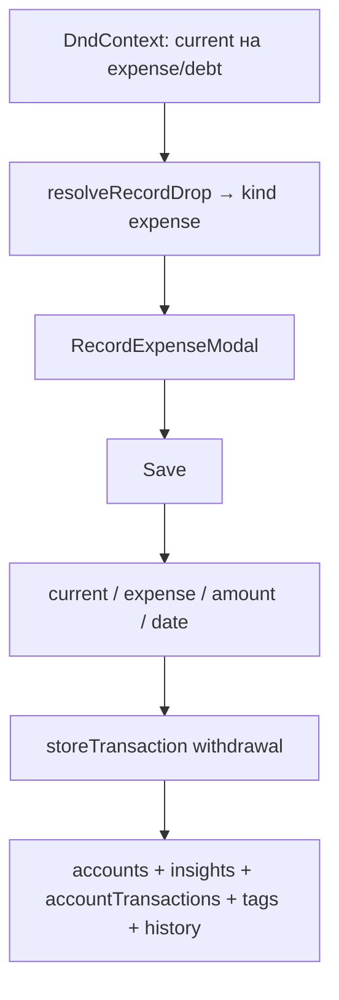

# US-025: записать расход перетаскиванием current на expense

**История:** [US-025](current-task/feature.json) — priority 25, первая с `passes: false`. Figma нет (`designReference: []`). PRD §1.5.2 / §1.5.2.1 (поля 1.5.2.1.1–10). FR-6, FR-7.

**Перед работой:** US-024 уже `passes: true` — общий DnD, `RecordIncomeModal`, `RecordTransactionFields`, `toTransactionStoreBody`, `createBudgetTransaction`, `invalidateTransactionQueries` готовы. Расход собирается из этих блоков, а не копируется.

**Вне скоупа:** RecordTransferModal (US-026, ветка `TRANSFER` остаётся no-op), sortable Edit (US-027–028), клик по транзакциям в Details (US-029), страница History (US-030). `src/api` не править.

**Расхождение PRD:** в §1.5.2.1.1/1.5.2.1.2 дефолты селектов описаны зеркально («current = куда бросили, expense = откуда drag»). Это опечатка: жест — current тащат на expense, значит current = source, expense = destination. Текст US-025 в feature.json это подтверждает — берём его: **Current = откуда начался drag, Expense = куда бросили** (аналог RecordIncome).

## Контекст

Готово (US-024):

- [`resolveRecordDrop`](src/modules/budget/helpers/transactions/resolveRecordDrop.ts) уже возвращает `{ kind: 'expense', source: current, destination: expense }` для `CURRENT → EXPENSE`. Debt-счета — `type: EXPENSE` + `isDebt: true` ([`mapFireflyAccount`](src/modules/budget/helpers/account/mapFireflyAccount.ts)), значит дроп на debt покрыт тем же кодом, отдельная ветка не нужна
- [`ACCOUNT_DND`](src/modules/budget/constants/accountDnd.ts) — таблица ролей; сейчас `CURRENT: { draggable: false, droppable: true }`, `EXPENSE: { draggable: false, droppable: false }`. Хук [`useAccountDndNode`](src/modules/budget/hooks/useAccountDndNode.ts) читает только флаги, карточку трогать не надо
- [`Budget.tsx`](src/modules/budget/Budget.tsx): в `switch` по `drop.kind` ветка `EXPENSE` сейчас no-op рядом с `TRANSFER`; сессия дохода `recordIncomeModal` — образец (`useModalSession<{ source, destination }>`)
- [`RecordIncomeModal`](src/modules/budget/components/RecordIncomeModal/RecordIncomeModal.tsx) — эталон разметки: `Modal centered`, `Select` + `allowDeselect={false}` + `searchable` через `toAccountSelectData`, `RecordTransactionFields`, `saveError`, Cancel/Save
- [`RecordTransactionFields`](src/modules/budget/components/RecordTransactionFields/RecordTransactionFields.tsx) — общий блок Amount + read-only Currency + Date (`maxDate=todayIso()`) + Description + `TagsField`
- [`useRecordIncomeForm`](src/modules/budget/hooks/useRecordIncomeForm.ts) — образец хука: `useForm` `mode: 'controlled'`, `isSubmitting`, `saveError`, submit через `form.onSubmit`
- [`toTransactionStoreBody`](src/modules/budget/helpers/transactions/toTransactionStoreBody.ts) — общий маппер, `type` — аргумент; `FIREFLY_TRANSACTION_TYPE.WITHDRAWAL` уже в [`constants/transactions.ts`](src/modules/budget/constants/transactions.ts)
- [`createBudgetTransaction`](src/modules/budget/helpers/transactions/createBudgetTransaction.ts) → `storeTransaction` `POST /v1/transactions`, результат `{ ok }`. Withdrawal: `source_id` = current (asset), `destination_id` = expense/liability, `amount` строка, `currency_code` валюты **current**
- [`invalidateTransactionQueries`](src/modules/budget/helpers/transactions/invalidateTransactionQueries.ts) — уже включает `BUDGET_ACCOUNTS_QUERY_KEY`, `BUDGET_INSIGHTS_QUERY_KEY`, `ACCOUNT_TRANSACTIONS_QUERY_KEY`, `TAGS_QUERY_KEY`, `HISTORY_TRANSACTIONS_QUERY_KEY`. Ничего добавлять не надо, `refetchQueries` поверх — нет
- Скрытые счета (`active: false`) отфильтрованы в `useBudgetAccounts` — селекты получают только видимые; `data[ACCOUNT_TYPE.EXPENSE]` уже включает debt
- `PointerSensor` distance `PAGE_SWIPE_AXIS_LOCK_PX` + `useClickAfterDrag`: клик по draggable-карточке по-прежнему открывает Details, свайп не крадёт pointer
- i18n: общие `budget.recordTransaction.*` (amount/currency/date/description/cancel/save/errors) уже есть; на модалку — только `budget.recordExpense.*`
- Vite dev на **5175**, HashRouter `/#/monetta/budget`



## Шаги

### 1. Роли DnD: current тащится, expense принимает

В [`accountDnd.ts`](src/modules/budget/constants/accountDnd.ts):

- `CURRENT: { draggable: true, droppable: true }` — current становится источником драга (droppable остаётся для income→current и будущего transfer)
- `EXPENSE: { draggable: false, droppable: true }` — expense/debt принимает дроп

`resolveRecordDrop` и `useAccountDndNode` не трогаем: классификация `CURRENT → EXPENSE` уже есть и покрывает debt. Побочка: current→current вернёт `kind: 'transfer'`, current→income — `null`; ветка `TRANSFER` в Budget остаётся no-op до US-026. Клик по current-карточке продолжает открывать Details (порог сенсора 8px), `isOver`-подсветка expense-карточки уже в `AccountItem` CSS.

### 2. `RecordExpenseModal` + форма

Новая папка [`src/modules/budget/components/RecordExpenseModal/`](src/modules/budget/components/RecordExpenseModal/) (`RecordExpenseModal.tsx` + `RecordExpenseModal.module.css` — содержимое модуля скопировать с RecordIncomeModal, та же `.form` / `.actions`). Одна модалка на Budget, не внутри сетки; `Modal.Stack` не нужен.

Поля (PRD §1.5.2.1):

- Current account — `Select` всех current; дефолт = source drag (`form.values.currentAccountId`)
- Expense account — `Select` всех expense + debt (`data[ACCOUNT_TYPE.EXPENSE]`); дефолт = destination drop
- `RecordTransactionFields`: Amount обязательное в валюте **выбранного current**; Currency read-only следует за селектом Current; Date — `defaultTransactionDate({ month, today: todayIso() })` через initial values; Description необязательное; Tags — `tagsEnabled={opened}`
- Cancel / оверлей / Escape — закрыть без `storeTransaction`

Хук [`src/modules/budget/hooks/useRecordExpenseForm.ts`](src/modules/budget/hooks/useRecordExpenseForm.ts) по образцу `useRecordIncomeForm`. Пропсы: `onClose`, `source`, `destination`, `currentAccounts`, `expenseAccounts`, `month`. Списки — из кеша Budget, без второго fetch.

Типы [`src/modules/budget/types/recordExpenseForm.ts`](src/modules/budget/types/recordExpenseForm.ts): `RecordExpenseFormValues { currentAccountId, expenseAccountId, amount, date, description, tags }`, `RecordExpenseFormFieldErrors`, `UseRecordExpenseFormParams` — зеркало `recordIncomeForm.ts` с переименованными ключами счетов.

Хелперы в `src/modules/budget/helpers/transactions/`:

- `initialRecordExpenseFormValues(sourceId, destinationId, month)` → `{ currentAccountId: sourceId, expenseAccountId: destinationId, amount: '', date: defaultTransactionDate({ month, today: todayIso() }), description: '', tags: [] }` — та же дата-логика, что у income
- `validateRecordExpenseForm(values)` — `currentAccountId` / `expenseAccountId` → `accountRequired`, `isValidTransactionAmount` → `amountRequired`, `date` → `dateRequired`; те же ключи `budget.recordTransaction.errors.*`

### 3. Save → `storeTransaction` (withdrawal) + инвалидация

В submit хука — как у income, только маппинг:

```ts
createBudgetTransaction(
  toTransactionStoreBody({
    type: FIREFLY_TRANSACTION_TYPE.WITHDRAWAL,
    sourceId: values.currentAccountId,      // current — источник денег
    destinationId: values.expenseAccountId, // expense/debt — назначение
    amount: Number(values.amount),
    currencyCode: selectedCurrent.currencyCode,
    date: values.date,
    description: values.description,
    tags: values.tags,
  }),
)
```

Пустой description уходит как есть (`''`), без fallback на имя счёта. То же правило вносим в [`useRecordIncomeForm`](src/modules/budget/hooks/useRecordIncomeForm.ts): убрать `|| selectedIncome.name` — description передаётся как ввёл пользователь; `selectedIncome` после этого не нужен, удалить его и из возврата хука (в `RecordIncomeModal` он не используется — проверить). Внимание: fallback добавили после 422 от живого Firefly на пустом description; если на withdrawal/deposit повторится 422 — зафиксировать это в verification и эскалировать, а не молча возвращать fallback. При `ok`: `invalidateTransactionQueries(queryClient)` → `onClose()`. Ошибка — `budget.recordTransaction.errors.saveFailed`, модалка не закрывается.

### 4. Проводка в `Budget.tsx`

- Соседняя сессия `recordExpenseModal = useModalSession<{ source, destination }>()` — не расширять income-сессию
- В `switch`: `case RECORD_DROP_KIND.EXPENSE: recordExpenseModal.open({ source: drop.source, destination: drop.destination }); return;` — `TRANSFER` остаётся no-op, `never`-guard сохранить
- Рендер как у RecordIncomeModal: `{recordExpenseModal.session.payload && <RecordExpenseModal key={session.id} ... currentAccounts={data?.[ACCOUNT_TYPE.CURRENT] ?? []} expenseAccounts={data?.[ACCOUNT_TYPE.EXPENSE] ?? []} month={month} />}`

### 5. i18n

В [`src/i18n/en.ts`](src/i18n/en.ts) рядом с `recordIncome`:

```ts
recordExpense: {
  title: 'Record expense',
  currentAccount: 'Current account',
  expenseAccount: 'Expense account',
},
```

Общие `budget.recordTransaction.*` и `tags.*` переиспользовать, новых error-ключей не добавлять.

### 6. Тесты хелперов

Vitest `*.test.ts` в `src/modules/budget/helpers/transactions/tests/`, `environment: 'node'`, фикстуры из `testHelpers.ts`:

- `validateRecordExpenseForm.test.ts` — пустые счета / `amount <= 0` / пустая дата → соответствующие ключи ошибок; валидная форма → `{}`
- `initialRecordExpenseFormValues.test.ts` — дефолты source→current / destination→expense, пустой amount/description/tags; дата = `defaultTransactionDate` (текущий и прошлый месяц)
- `toTransactionStoreBody` уже покрыт generic-типом — при желании один кейс `WITHDRAWAL` (source=current, destination=expense), без дублирования всех полей
- `resolveRecordDrop.test.ts` — добавить кейс дропа на debt-фикстуру (`type: EXPENSE, isDebt: true`) → `kind: 'expense'`

## Проверка

1. `npm test`
2. `npx tsc -b --pretty false`
3. `npm run lint`
4. Браузер (agent-browser): Vite 5175, `/#/monetta/budget`, живой PAT. Прогнать поток, не один скриншот. Mobile (`<961px`) и desktop.

Чеклист:

- Клик по current-карточке по-прежнему открывает Details (drag-порог не ломает клик); Add / Create / Edit / Hide / Delete без регрессии
- Горизонтальный свайп Income/Current/Expense листает страницы
- Drag current на expense открывает Record expense; дефолты: Current = откуда тянули, Expense = куда бросили; селекты без скрытых; debt-счета в списке Expense
- Drag current на debt тоже открывает Record expense с debt в Expense account
- Amount обязателен (`<= 0` и пусто блокируют Save); Currency read-only следует за выбранным current; Date = today на текущем месяце и 1-е число на прошлом; будущие дни в календаре выключены
- Tags: Enter и бейджи, Enter не сабмитит форму
- Cancel и оверлей не пишут транзакцию
- Save: withdrawal в Firefly; баланс current уменьшился, Expenses в parameters bar обновился без перезагрузки; транзакция видна в Details обоих счетов
- Save с пустым Description уходит с пустым описанием (без подмены именем счёта); если Firefly отвечает 422 — записать в progress и остановиться, fallback не возвращать
- Drag current→current и income→income модалку не открывают (TRANSFER — no-op до US-026)
- Record income по-прежнему работает; Save с пустым Description в income-модалке тоже уходит с пустым описанием

Готово, когда расход создаётся жестом current→expense/debt, typecheck зелёный, `"passes": true` у US-025. Записать итог в [`current-task/progress.txt`](current-task/progress.txt) и [`current-task/learnings.txt`](current-task/learnings.txt).
