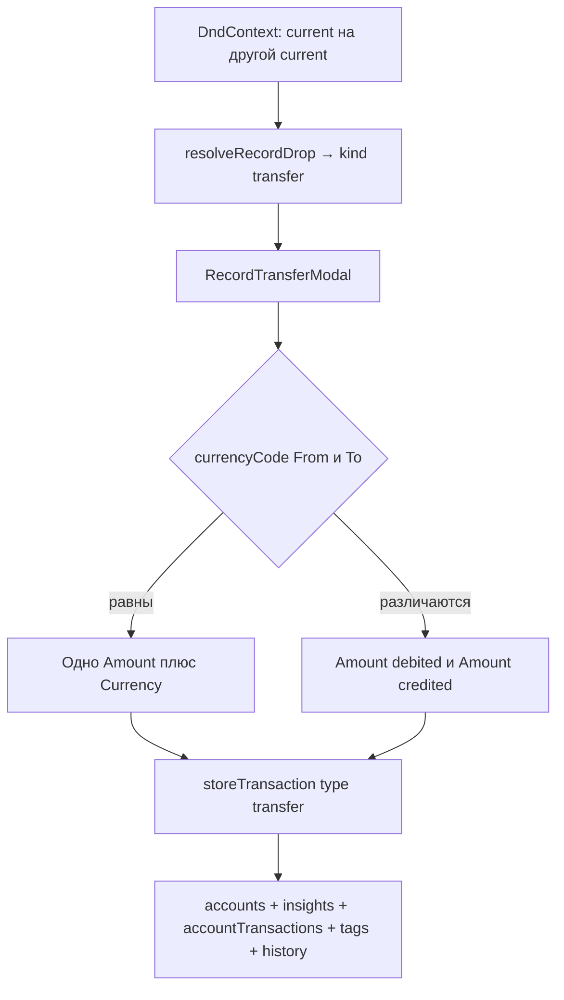

# US-026: записать перевод перетаскиванием current на current

**История:** [US-026](current-task/feature.json) — priority 26, первая с `passes: false`. Figma нет (`designReference: []`). PRD §1.5.3 / §1.5.3.1 (поля 1.5.3.1.1–10). FR-6, FR-7.

**Уже есть:** US-024 и US-025 собраны в одну [`RecordTransactionModal`](src/modules/budget/components/RecordTransactionModal/RecordTransactionModal.tsx). [`resolveRecordDrop`](src/modules/budget/helpers/transactions/resolveRecordDrop.ts) уже возвращает `{ kind: 'transfer', source, destination }` для current→current с разными id. [`ACCOUNT_DND`](src/modules/budget/constants/accountDnd.ts) уже даёт CURRENT `draggable` и `droppable`. В [`Budget.tsx`](src/modules/budget/Budget.tsx) ветка `TRANSFER` выходит сразу. `FIREFLY_TRANSACTION_TYPE.TRANSFER` уже лежит в [`constants/transactions.ts`](src/modules/budget/constants/transactions.ts).

Перевод живёт в отдельной `RecordTransferModal`. [`recordTransactionKindConfig`](src/modules/budget/helpers/transactions/recordTransactionKind.ts) остаётся только для income и expense: там одна сумма и валюта стороны CURRENT. `toRecordTransactionDrop` по-прежнему отбрасывает transfer.

**Дальше по очереди:** sortable Edit (US-027–028), клик по транзакции (US-029), страница History (US-030). `src/api` не править.

## Контекст

- Жест уже классифицирован. Дроп на ту же карточку — `null` (`active.id === over.id`). Скрытые счета отфильтрованы в `useBudgetAccounts`, оба селекта получают `data[ACCOUNT_TYPE.CURRENT]`.
- Одна сессия `useModalSession<RecordDrop>` (`recordModal`). Income/expense монтируют `RecordTransactionModal`, когда `toRecordTransactionDrop` вернул дроп. Transfer монтируется рядом, когда payload — transfer.
- Общие куски Save уже есть и их хватает: [`toTransactionStoreBody`](src/modules/budget/helpers/transactions/toTransactionStoreBody.ts) (`date` → `${date}T12:00:00`, пустое описание → U+2066 через `transactionDescription`, теги только если список не пуст), [`createBudgetTransaction`](src/modules/budget/helpers/transactions/createBudgetTransaction.ts) (`storeTransaction`, результат `{ ok }`), [`invalidateTransactionQueries`](src/modules/budget/helpers/transactions/invalidateTransactionQueries.ts) (accounts, insights, accountTransactions, tags, history). Поверх `invalidateQueries` второй `refetchQueries` не ставить.
- Схема split ([`TransactionSplitStore`](src/api/types.gen.ts)): `amount` + `currency_code` и опциональные `foreign_amount` + `foreign_currency_code`. Для transfer source и destination — asset (current). `amount` — сумма в валюте From (списание). `foreign_amount` — сумма в валюте To (зачисление). Одинаковая валюта: foreign-поля не отправлять.
- Дата как у income/expense: [`defaultTransactionDate`](src/modules/budget/helpers/month/budgetMonth.ts) — сегодня, если выбран текущий месяц Budget, иначе первое число этого месяца. `maxDate` календаря — `todayIso()`.
- Пустое описание остаётся необязательным в форме и уходит как U+2066. Именем счёта описание не подменять.
- i18n: общие `budget.recordTransaction.*` (amount, currency, date, description, cancel, save, errors). Новые строки — `budget.recordTransfer.*` в [`src/i18n/en.ts`](src/i18n/en.ts). Интерфейс V1 английский.
- Vite на **5175** (`strictPort`), HashRouter `/#/monetta/budget`.
- Vitest — `environment: 'node'`, тесты helpers в [`src/modules/budget/helpers/transactions/tests/`](src/modules/budget/helpers/transactions/tests/). Компонентные тесты не писать.

## Шаги

### 1. Открыть модалку с дропа

В [`Budget.tsx`](src/modules/budget/Budget.tsx) ветка `RECORD_DROP_KIND.TRANSFER` вызывает `recordModal.open(drop)` — та же сессия, что у income и expense.

Рядом с `toRecordTransactionDrop` добавить `toRecordTransferDrop`: kind `transfer` → `{ source, destination }`, иначе `null`. Пока payload — transfer, монтировать `RecordTransferModal` (`key={recordModal.session.id}`, `opened={recordModal.session.opened}`, `onClose` / `onExitTransitionEnd` как у income). `RecordTransactionModal` при этом не монтируется: `toRecordTransactionDrop` для transfer уже возвращает `null`.

`ACCOUNT_DND`, `resolveRecordDrop` и `useAccountDnd` не менять. Клик по current-карточке по-прежнему открывает Details (порог `PointerSensor`).

### 2. `RecordTransferModal` и форма

Новая папка [`src/modules/budget/components/RecordTransferModal/`](src/modules/budget/components/RecordTransferModal/) (`RecordTransferModal.tsx` + `RecordTransferModal.module.css`). Разметка как у [`RecordTransactionModal`](src/modules/budget/components/RecordTransactionModal/RecordTransactionModal.tsx): `Modal centered`, форма, `Select` `allowDeselect={false}` `searchable` через `toAccountSelectData`, ошибка Save, Cancel / Save. `Modal.Stack` не нужен. Модалка одна на Budget, не внутри сетки.

Поля (PRD §1.5.3.1, текст US-026):

- **From** — все видимые current, по умолчанию счёт, с которого начался drag (`drop.source.id`).
- **To** — те же current, по умолчанию счёт, на который бросили (`drop.destination.id`).
- Одинаковый `currencyCode` у выбранных From и To: одно обязательное Amount и read-only Currency этой валюты.
- Разный `currencyCode`: обязательные **Amount debited** (валюта From) и **Amount credited** (валюта To), у каждого своя read-only Currency.
- Date, Description, Tags — как в `RecordTransactionFields` (`TagsField`, `tagsEnabled={opened}`).

Значения формы — отдельный тип [`recordTransferForm.ts`](src/modules/budget/types/recordTransferForm.ts) рядом с income/expense, не расширять `RecordTransactionFormValues` вторым amount:

`sourceAccountId`, `destinationAccountId`, `amount` (общая сумма или debited), `foreignAmount` (credited, в UI только при разной валюте), `date`, `description`, `tags`.

Хелперы рядом с существующими transaction-хелперами:

- `initialRecordTransferFormValues(sourceId, destinationId, month)` — пустые суммы, дата через `defaultTransactionDate`.
- `transferCurrenciesDiffer(source, destination)` — оба счёта найдены и `currencyCode` различаются.
- `validateRecordTransferForm` — id нет в списке current → `budget.recordTransaction.errors.accountRequired`; From и To — один и тот же id → ошибка на To (`budget.recordTransfer.errors.sameAccount`); `amount` через уже существующий `isValidTransactionAmount` (`> 0`); при разной валюте то же для `foreignAmount`; пустая дата → `dateRequired`. При одинаковой валюте `foreignAmount` не валидировать и в запрос не класть. Смена селекта режим не сбрасывает: лишнее credited просто скрыто и не уходит в Firefly, пустой credited при разной валюте ловит валидация.

Хук [`useRecordTransferForm`](src/modules/budget/hooks/useRecordTransferForm.ts) повторяет каркас `useRecordTransactionForm` (controlled `useForm`, `isSubmitting`, `saveError`, `form.onSubmit`), без ветки `kind` внутри income/expense-хука. Валюты для подписей — `currencyCode` выбранных счетов. Пока счёт не резолвится, Currency пустая строка.

Ряд Amount + Currency вынести в маленький `RecordAmountRow` в папке `RecordTransactionFields` (те же классы [`.amountRow`](src/modules/budget/components/RecordTransactionFields/RecordTransactionFields.module.css)). `RecordTransactionFields` снаружи для income/expense остаётся с одним amount. `RecordTransferModal` рисует один или два ряда (лейблы Amount / Amount debited / Amount credited), затем дату, описание и теги. `data-autofocus` только на первом числе.

i18n:

- `budget.recordTransfer.title` — `Record transfer`
- `budget.recordTransfer.from` — `From`
- `budget.recordTransfer.to` — `To`
- `budget.recordTransfer.amountDebited` — `Amount debited`
- `budget.recordTransfer.amountCredited` — `Amount credited`
- `budget.recordTransfer.errors.sameAccount` — `Choose a different account`

Cancel, Save, Date, Description, Tags, ошибки amount/date/account/saveFailed — уже существующие ключи `budget.recordTransaction.*`.

### 3. Save → `transfer` в Firefly

Расширить [`ToTransactionStoreBodyInput`](src/modules/budget/types/createBudgetTransaction.ts) опциональными `foreignAmount` и `foreignCurrencyCode`. В [`toTransactionStoreBody`](src/modules/budget/helpers/transactions/toTransactionStoreBody.ts) писать `foreign_amount: String(foreignAmount)` и `foreign_currency_code` только когда переданы оба. Income и expense эти поля не передают, их тело не меняется.

Submit перевода:

- Одинаковая валюта: `type: transfer`, `source_id` = From, `destination_id` = To, `amount` = введённая сумма, `currency_code` = валюта From (она же To).
- Разная валюта: то же плюс `foreign_amount` = credited, `foreign_currency_code` = валюта To. `amount` / `currency_code` — debited / валюта From.
- Дальше тот же `createBudgetTransaction` → при `ok` `invalidateTransactionQueries` и `onClose`. Ошибка — `budget.recordTransaction.errors.saveFailed`, модалка остаётся открытой.

### 4. Тесты

В [`helpers/transactions/tests/`](src/modules/budget/helpers/transactions/tests/):

- `validateRecordTransferForm.test.ts` — счета не из списка; From = To; одинаковая валюта и пустой/`<= 0` amount; разная валюта и пустой credited; пустая дата; валидные same и cross → `{}`. Описание не требуется.
- `initialRecordTransferFormValues.test.ts` — дефолты From/To, пустые суммы и теги, дата = `defaultTransactionDate` для текущего и прошлого месяца.
- `toTransactionStoreBody.test.ts` — same-currency transfer без `foreign_*`; cross-currency с `foreign_amount` строкой и `foreign_currency_code`. Пустое описание по-прежнему U+2066.
- `recordTransactionKind.test.ts` — `toRecordTransferDrop` оставляет transfer и отбрасывает income/expense. Существующий кейс «transfer не открывает income/expense форму» оставить.

## Проверка

1. `npm test`
2. `npx tsc -b --pretty false`
3. `npm run lint`
4. Браузер: Vite 5175, `/#/monetta/budget`, живой PAT. Прогнать поток целиком. Mobile (`<961px`) и desktop.

Чеклист:

- Клик по current-карточке открывает Details; горизонтальный свайп блоков листает страницы; income→current и current→expense/debt по-прежнему открывают Record income / Record expense и сохраняются.
- Drag current на другой current открывает Record transfer. From = откуда тянули, To = куда бросили. Оба селекта — только видимые current.
- Одинаковая валюта: одно Amount и read-only Currency. Разная: Amount debited (валюта From) и Amount credited (валюта To). Смена селекта переключает набор полей.
- Пустая сумма, `<= 0`, пустая дата и одинаковые From/To блокируют Save. Cancel и клик по оверлею закрывают без запроса.
- Date = сегодня на текущем месяце Budget и 1-е число на прошлом; будущие дни выключены. Tags: Enter и бейдж, Enter не сабмитит форму.
- Save same-currency: в Firefly `transfer`, баланс From уменьшился, баланс To вырос, Balance в parameters bar обновился без перезагрузки. Транзакция видна в Details обоих счетов.
- Save cross-currency: в теле `amount` + `currency_code` From и `foreign_amount` + `foreign_currency_code` To. Балансы сдвинулись на соответствующие суммы.
- Пустое Description уходит через `transactionDescription` (U+2066), без подстановки имени счёта.
- Дроп current на ту же карточку модалку не открывает.

Готово, когда перевод создаётся жестом current→current, typecheck зелёный и у US-026 стоит `"passes": true`. Итог записать в [`current-task/progress.txt`](current-task/progress.txt) и [`current-task/learnings.txt`](current-task/learnings.txt).
