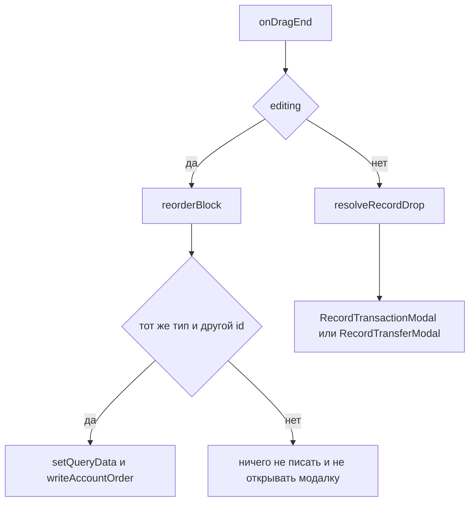

# US-027: порядок счетов в режиме Edit

Figma-ссылок в `designReference` нет.

Свайп страниц во время активного драга уже выключен: [AccountBlockViewport.tsx](src/modules/budget/components/AccountBlock/AccountBlockPager/AccountBlockViewport/AccountBlockViewport.tsx) передаёт в `usePageSwipe` `enabled: !active`. Перелистывание у края карточки не делать — это US-028.

## Поведение

- Карандаш в [ParametersBar.tsx](src/modules/budget/components/ParametersBar/ParametersBar.tsx) переключает режим. Сейчас у кнопки есть `aria-label` `budget.parameters.edit` и нет `onClick`. Добавить `editing` и `onEditToggle`: `aria-pressed`, в нажатом состоянии `variant="filled"`. Новых строк i18n не нужно.
- Состояние `editing` живёт в [Budget.tsx](src/modules/budget/Budget.tsx) и уходит в бар и в блоки.
- Вне Edit всё остаётся как сейчас: `ACCOUNT_DND` (income тащится, current тащится и принимает, expense только принимает), `resolveRecordDrop` открывает `RecordTransactionModal` / `RecordTransferModal`.
- В Edit любой счёт блока (income, current, expense и debt) переставляется только внутри своего блока. `SortableContext` на текущей странице, `items` — id счетов этой страницы, стратегия `rectSortingStrategy` (один ряд у Income/Current и сетка у Expense).
- В Edit слот Add не показывать. [toAccountPageItems.ts](src/modules/budget/helpers/layout/toAccountPageItems.ts) принимает флаг и не добавляет `{ type: 'add' }`, пока режим включён. [useAccountBlockPager.ts](src/modules/budget/hooks/useAccountBlockPager.ts) считает страницы уже без этого слота, `clampPageIndex` поджимает текущую страницу, если она держалась только на Add. Вне Edit Add снова последний слот. В `monetta.accountOrder.*` id слота Add нет и в Edit тоже не появляется.
- В Edit клик, Enter и Space по карточке не открывают `AccountDetailsModal`. Карточка остаётся ручкой перетаскивания, без `onSelectAccount`. Вне Edit клик по-прежнему открывает детали; жест драга по-прежнему отделён от клика через `AccountPointerSensor` и `useClickAfterDrag`.
- Стрелки и точки вне драга работают. Пока `DndContext.active` задан, свайп не листает страницу.

## Сортировка в сетке

Один `DndContext` в `Budget` остаётся. В режиме Edit `useAccountDnd` передаёт `collisionDetection`: `closestCenter`, контейнеры отфильтрованы по `data.account.type` активного счёта, чтобы income не сдвигал current/expense.

Хуки нельзя вызывать условно, а `useDraggable` и `useSortable` с одним id вместе регистрировать нельзя. В [AccountPageGrid.tsx](src/modules/budget/components/AccountBlock/AccountPageGrid/AccountPageGrid.tsx) при `sorting` рендерить отдельную карточку на `useSortable` (`id`, `data: { account }`), иначе текущий [InteractiveAccountItem.tsx](src/modules/budget/components/AccountItem/InteractiveAccountItem.tsx). `SortableContext` оборачивает только интерактивный слайд (prev/next остаются `inert` и без хуков).

`AccountItem` принимает `style` с `transform` и `transition` из `useSortable` (`CSS` из `@dnd-kit/utilities`). `DragOverlay` остаётся. Соседние карточки сдвигаются трансформами стратегии; исходная карточка по-прежнему приглушается классом `isDragging`.

Проп `sorting` провести по уже существующей цепочке: `AccountBlock` → pager → viewport → grid.

## Запись порядка

Чистая функция рядом с [sortAccountsByOrder.ts](src/modules/budget/helpers/account/sortAccountsByOrder.ts), тесты в [helpers/tests](src/modules/budget/helpers/tests):

- `reorderBlock(accounts, active, over)` возвращает новый массив или `null`.
- `null`, если типы разные, id совпадают или id нет в списке.
- Иначе `arrayMove` из `@dnd-kit/sortable` по индексам в полном списке блока. Счета на других страницах остаются на своих местах, потому что двигаются только два id текущей страницы.
- Debt и expense — один список `EXPENSE` и ключ `monetta.accountOrder.expense`.

`useAccountDnd` в Edit не вызывает `resolveRecordDrop` и не зовёт открытие деталей. Если `reorderBlock` вернул список, хук записи:

- сразу кладёт новый порядок в кеш `['budget', 'accounts', date]` через `setQueryData` и `sortAccountsByOrder`, чтобы сетка не прыгала назад;
- вызывает уже существующий [writeAccountOrder](src/modules/budget/helpers/account/writeAccountPreferences.ts) (`PUT`, при 404 — `POST`);
- при ошибке записи делает `invalidateQueries` по префиксу `BUDGET_ACCOUNTS_QUERY_KEY`, чтобы вернуть порядок с сервера;
- при успехе тот же префикс тоже инвалидировать, чтобы кеш других месяцев не остался со старым порядком.

Инсайты и транзакции не трогать: порядок счетов их не меняет.

## Проверка

- `npx tsc -b`
- `npm run lint`
- `npm test` — кейсы `reorderBlock`: обмен внутри списка, счета вне пары не двигаются, тот же id и чужой тип дают `null`. Кейс `toAccountPageItems`: без флага Add последний, с флагом Edit в списке только счета.
- Браузер на Budget: Edit — слота Add нет ни в одном блоке; клик, Enter и Space по карточке не открывают детали. Перетащить income внутри income и expense/debt внутри expense — порядок на сетке меняется и после обновления страницы тот же. Дроп current на current и current на expense не открывает модалки. Выключить Edit — Add снова последний слот, клик открывает детали, те же дропы снова открывают перевод и расход. Во время удержания карточки свайп страницу не листает; без драга свайп, стрелки и точки листают. Перенос на другую страницу не проверять как готовую фичу.
