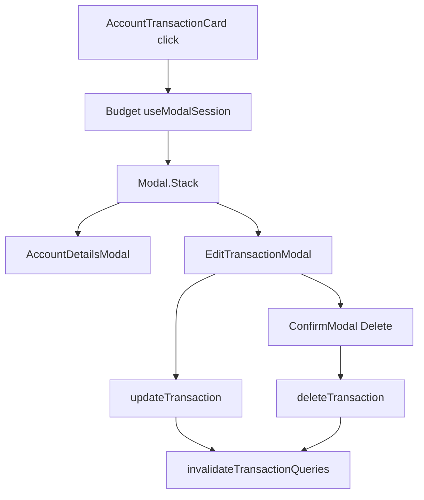

# US-029: Редактировать или удалять транзакцию из AccountDetailsModal

Следующая история с `passes: false` и наивысшим приоритетом: **US-029**. Ссылки Figma в `designReference` нет.

## Цель

Клик по карточке транзакции в деталях счёта открывает общую `EditTransactionModal` (в [`src/components`](src/components)): правка From/To/суммы/даты/описания/тегов и удаление с подтверждением. Save/Delete пишут в Firefly, инвалидируют счета Budget и History, закрывают модалку.

## Контекст и опора

- Карточки сейчас display-only: [`AccountTransactionCard.tsx`](src/modules/budget/components/AccountDetailsModal/AccountTransactionCard/AccountTransactionCard.tsx) — без `onClick`.
- Создание уже есть: [`RecordTransactionModal`](src/modules/budget/components/RecordTransactionModal/RecordTransactionModal.tsx), [`RecordTransferModal`](src/modules/budget/components/RecordTransferModal/RecordTransferModal.tsx), [`RecordTransactionFields`](src/modules/budget/components/RecordTransactionFields), [`toTransactionStoreBody`](src/modules/budget/helpers/transactions/toTransactionStoreBody.ts), [`invalidateTransactionQueries`](src/modules/budget/helpers/transactions/invalidateTransactionQueries.ts).
- SDK: `updateTransaction` / `deleteTransaction` в [`src/api/sdk.gen.ts`](src/api/sdk.gen.ts) (path `id` = group id).
- Стек модалок Details + Edit account: [`Budget.tsx`](src/modules/budget/Budget.tsx) + `Modal.Stack` + `useModalSession`.
- Подтверждения: [`ConfirmModal`](src/modules/budget/components/ConfirmModal/ConfirmModal.tsx).

## Зафиксированные решения

- Редактируются только `deposit` / `withdrawal` / `transfer`. Карточки `reconciliation` / `opening balance` остаются без клика.
- Тип транзакции не меняется; селекты From/To — как в PRD 1.6.4 (Income→Current, Current→Expense(+debt), Current→Current).
- Мультивалютный transfer: поля Debited/Credited через уже существующий `transferCurrenciesDiffer` + `RecordAmountRow`.
- Модель [`AccountTransaction`](src/modules/budget/types/accountTransaction.ts) расширяется полями `foreignAmount` / `foreignCurrencyCode` (из `foreign_amount` в `toAccountTransactions`), иначе edit не сможет префиллить Credited.
- `transaction_journal_id` в PUT только если `journalId` реальный (не fallback `` `${groupId}:${index}` ``).
- Пустое description при prefilling: `hasTransactionDescription` → `''`; при save снова `transactionDescription()`.
- Сессия edit transaction живёт в `Budget` рядом с `editModal` (как Edit account), чтобы `Modal.Stack` покрывал Details → EditTransaction → Delete confirm; Details не закрывается поверх открытого edit.

## Шаги реализации

### 1. Данные и API-helpers

- В [`accountTransaction.ts`](src/modules/budget/types/accountTransaction.ts) и [`toAccountTransactions.ts`](src/modules/budget/helpers/transactions/toAccountTransactions.ts): маппить `foreign_amount` / `foreign_currency_code`.
- Добавить в `src/modules/budget/helpers/transactions/`:
  - `toTransactionUpdateBody` — body для PUT (`transactions: [{ transaction_journal_id?, type, source_id, destination_id, amount, currency_code, foreign_*, date, description, tags }]`, дата `` `${date}T12:00:00` ``).
  - `updateBudgetTransaction(groupId, body)` → `{ ok }` через `updateTransaction`.
  - `deleteBudgetTransaction(groupId)` → `{ ok }` через `deleteTransaction` + `response.ok` (204), по образцу delete account.
- Тесты helpers в `helpers/tests/` / рядом с функцией по правилам модуля.

### 2. `EditTransactionModal` в `src/components`

- Папка [`src/components/EditTransactionModal/`](src/components/EditTransactionModal/) (+ CSS module рядом).
- Props: `opened`, `onClose`, `onExitTransitionEnd`, `transaction: AccountTransaction`, `accounts: BudgetAccountsByBlock`, `stackId`.
- UI: From/To `Select` (`toAccountSelectData` по типу), `RecordTransactionFields` (amount или debited/credited), кнопки Delete / Cancel / Save.
- Form hook (в `src/modules/budget/hooks` или рядом с модалкой в components — предпочтительно hook в budget, UI в components): валидация как у record/transfer; Save → update → `invalidateTransactionQueries` → `onClose`.
- Delete → sibling `ConfirmModal` с текстом ровно: `Delete this transaction? This action cannot be undone.` → delete → invalidate → закрыть edit (Details остаётся открытым, список обновится по query).
- i18n ключи в [`src/i18n/en.ts`](src/i18n/en.ts) (`budget.editTransaction.*`); переиспользовать label'ы amount/date/tags где возможно.

### 3. Проводка из AccountDetails

- [`AccountTransactionCard`](src/modules/budget/components/AccountDetailsModal/AccountTransactionCard/AccountTransactionCard.tsx): `role="button"`, Enter/Space, `onClick` (только для editable types).
- Пробросить `onTransactionClick` через List → Body → Details.
- В [`Budget.tsx`](src/modules/budget/Budget.tsx): `useModalSession<AccountTransaction>()`, расширить условие `Modal.Stack` (`details || editAccount || editTransaction`), смонтировать `EditTransactionModal` третьим sibling; передать `accounts={data}` (или empty fallback).
- Пока открыт edit transaction — не закрывать Details кликом снаружи (тот же подход, что для Edit account: стек и блокировка dismiss на Details при необходимости).

### 4. Verification

- `npx tsc -b --pretty false` (или `npm run build` typecheck-часть)
- `npm test`
- `npm run lint`
- Browser (agent-browser): открыть Budget → детали счёта → клик по deposit/withdrawal/transfer → изменить сумму/дату → Save → карточка и баланс обновились; Delete → confirm copy → транзакция исчезла; Cancel/overlay без записи; multi-currency transfer показывает Debited/Credited.
