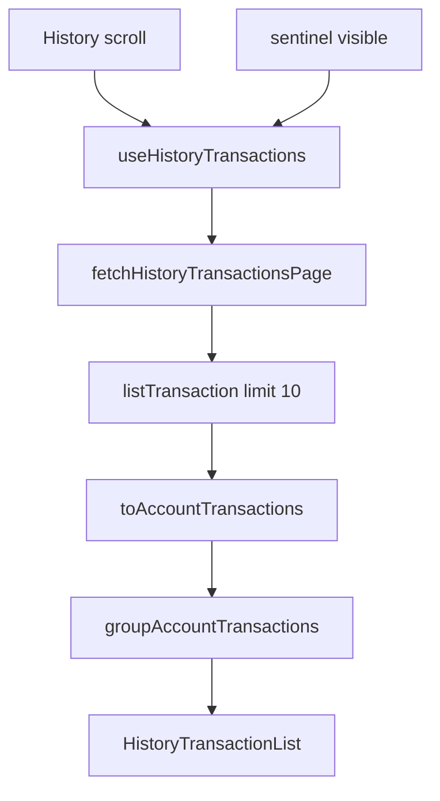

# US-030: Список History с подгрузкой по скроллу

Следующая история с `passes: false` и наивысшим приоритетом: **US-030**. Ссылки Figma в `designReference` нет.

Поиск, фильтры, кнопка сортировки и клик по карточке — US-031–US-034.

## Цель

Страница History показывает все транзакции кошелька, сгруппированные по дате: From, To, сумма, описание, теги, тип. Первая загрузка — 10 групп Firefly, скролл к концу догружает следующие по 10.

## Контекст и опора

- Заглушка: [`History.tsx`](src/modules/history/History.tsx). Маршрут `ROUTE.HISTORY` уже в [`AppRouter.tsx`](src/router/AppRouter.tsx).
- Ключ [`HISTORY_TRANSACTIONS_QUERY_KEY`](src/modules/history/constants/queries.ts) уже входит в [`invalidateTransactionQueries`](src/modules/budget/helpers/transactions/invalidateTransactionQueries.ts).
- Сплиты: [`toAccountTransactions`](src/modules/budget/helpers/transactions/toAccountTransactions.ts). Группы по дате, новые сверху: [`groupAccountTransactions`](src/modules/budget/helpers/transactions/groupAccountTransactions.ts). Сумма: [`formatAccountAmount`](src/modules/budget/helpers/account/formatAccountAmount.ts). Пустое описание: [`hasTransactionDescription`](src/modules/budget/helpers/transactions/transactionDescription.ts).
- SDK: `listTransaction`, query только `limit` / `page` / `start` / `end` / `type`. `src/api` не менять.
- `AppLayout` `main` — `overflow: hidden`; скролл принадлежит странице. Dev-сервер: порт `5175`, `strictPort`.
- Цвета сумм как у карточки в деталях счёта: `var(--mantine-color-red-6)` и `var(--mantine-color-green-6)`.

## Зафиксированные решения

- Страница Firefly — 10 групп (`limit: 10`). Группа с несколькими сплитами даёт несколько карточек. Резать список до ровно 10 карточек нельзя: сломается `meta.pagination`.
- `collectFireflyPages` не использовать: он забирает все страницы. `start`, `end` и `type` не передавать.
- Ключ запроса — существующий `HISTORY_TRANSACTIONS_QUERY_KEY`, чтобы запись на Budget обновляла History. Провайдер и persist не трогать. Без `placeholderData`.
- Одинаковая валюта или пустой `foreignAmount` — одна сумма. Разная валюта — `−` списано красным и `+` зачислено зелёным. Символ иностранной валюты в `AccountTransaction` не добавлять: форматтер берёт `foreignCurrencyCode`.
- Карточка своя, не `AccountTransactionCard`: там цвет зависит от счёта и нет тегов с типом. Карточка пока не кнопка.
- Тип — `Record<TransactionTypeProperty, i18n key>`, без `switch` с `never`.

## Шаги реализации

### 1. Одна страница Firefly

- Константа `HISTORY_TRANSACTIONS_PAGE_LIMIT = 10` в [`src/modules/history/constants/queries.ts`](src/modules/history/constants/queries.ts). Свой лимит, не переиспользовать чужие `50`.
- `fetchHistoryTransactionsPage(page)` в `src/modules/history/helpers/`: `listTransaction({ query: { page, limit } })`.
- Ответ: `{ items, page, totalPages }`. `totalPages` из `meta.pagination.total_pages`; если meta нет — текущая страница последняя.
- Пустой `data: []` — пустой список. Нет `data` — своя ошибка, по тому же правилу, что у транзакций счёта.
- Сплиты — `toAccountTransactions`.

### 2. Сумма на карточке

- Чистая функция в `src/modules/history/helpers/`: одна сумма или пара debited/credited.
- Пара, когда `foreignAmount != null` и код иностранной валюты отличается от кода источника.
- Суммы через `formatAccountAmount`. Знаки `−` и `+` ставит карточка.

### 3. Query

- `useHistoryTransactions` в `src/modules/history/hooks/` на `useInfiniteQuery`.
- `initialPageParam: 1`. Следующая страница есть, пока `page < totalPages`.
- Страницы склеить и отдать в `groupAccountTransactions`. День на границе страниц склеивается. Порядок дат — от новых к старым.

### 4. Экран

- [`History.tsx`](src/modules/history/History.tsx) + `History.module.css`: колонка `height: 100%`, `min-height: 0`, `overflow: auto`.
- Компоненты в `src/modules/history/components/`, CSS-модуль рядом с компонентом.
- Список: секции по дате, подпись `D MMM YYYY` из `groupAccountTransactions`.
- Карточка: From, To, описание только при `hasTransactionDescription`, теги, тип.
- Подписи типов в [`src/i18n/en.ts`](src/i18n/en.ts): Deposit, Withdrawal, Transfer, Reconciliation, Opening balance. Остальные строки под `history.*`: from, to, empty (`No transactions found`), loading, loadFailed.
- Первая загрузка без кеша — текст загрузки. Есть страницы — список остаётся и при refetch, и при подгрузке. Ошибка без данных — текст ошибки. Ошибка следующей страницы — список остаётся, ошибка под ним. Пустая первая страница — empty.
- Sentinel внизу списка и `useIntersection` из `@mantine/hooks`. `root` — скролл страницы. `fetchNextPage` только когда sentinel виден, следующая страница есть и запрос ещё не идёт.

### 5. Verification

- Тесты в `src/modules/history/helpers/tests/`. Мок `listTransaction` из `@/api/sdk.gen.ts`: вызов с `page` и `limit: 10` без `start` / `end` / `type`; пустой `data` и отсутствующий `data`; `totalPages` из meta; одна сумма и пара списано/зачислено.
- `npx tsc -b --pretty false`
- `npm test`
- `npm run lint`
- Браузер на `http://localhost:5175/monetta/history`: группы по дате, From/To, описание, теги, тип; первая порция — 10 групп; скролл догружает следующую; перевод в разных валютах показывает красный минус и зелёный плюс; после записи транзакции на Budget список обновляется без перезагрузки; карточка не открывает правку.
