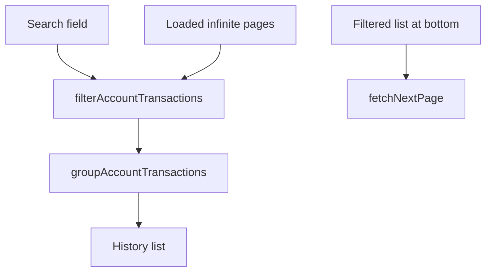

# US-031: Искать по History

Следующая история с `passes: false` и наивысшим приоритетом: **US-031**. Ссылки Figma в `designReference` нет.

Фильтры (US-032) и переключатель сортировки (US-033) в эту историю не входят. Поиск фильтрует уже загруженный результат запроса, поэтому позже он останется последним шагом поверх фильтра и порядка.

## Цель

Над списком History — поле поиска. Оно оставляет транзакции, у которых описание, имена From/To, валюта, сумма, теги, тип или дата содержат запрос. Пустой запрос показывает весь загруженный список.

## Опора

- Список и подгрузка: [`History.tsx`](src/modules/history/History.tsx), [`useHistoryList.ts`](src/modules/history/hooks/useHistoryList.ts), [`useHistoryTransactions.ts`](src/modules/history/hooks/useHistoryTransactions.ts). Скролл сейчас на всей странице.
- Тот же отбор, что в деталях счёта: [`filterAccountTransactions`](src/modules/budget/helpers/transactions/filterAccountTransactions.ts) — регистр не важен, пустой и пробельный запрос возвращает всё. Сейчас в строку поиска входят описание, имена, код и символ валюты, сумма, сырой тип и теги.
- На карточке History ещё видны дата группы, зачисленная сумма и код иностранной валюты. Их в этом фильтре нет.
- `listTransaction` не принимает строку поиска. Ключ `HISTORY_TRANSACTIONS_QUERY_KEY` не менять: поиск не должен перезапрашивать Firefly.

## Решения

- Фильтровать плоский список загруженных страниц, затем группировать через `groupAccountTransactions`. Совпадение на границе дня не разрывает секцию.
- Дополнить `filterAccountTransactions` видимыми полями History: `foreignAmount` (если не `null`), `foreignCurrencyCode`, календарный день и подпись группы (`formatAccountTransactionGroupDate`). Детали счёта используют тот же хелпер, новые поля для них тоже ищутся.
- Подпись типа на карточке («Withdrawal», «Opening balance») уже совпадает с сырым `type` после нижнего регистра. Отдельную таблицу i18n в фильтр не класть.
- Поле закрепить над списком. Скролл и `scrollRoot` перенести на область списка, иначе проверка «у нижнего края» останется на странице, которая больше не скроллится.
- Пока после фильтра ничего не видно и следующая страница ещё есть, нижний край короткого списка по-прежнему вызывает `fetchNextPage`. Проверку низа повторять при смене запроса и числа отфильтрованных групп, не только при `pageCount`. Текст «No transactions found» показывать, когда страницы уже есть, совпадений нет и следующей страницы нет. Пока страницы догружаются, остаётся индикатор загрузки.
- Карточки по-прежнему не кнопки.

## Шаги

1. В [`filterAccountTransactions.ts`](src/modules/budget/helpers/transactions/filterAccountTransactions.ts) добавить в искомую строку иностранную сумму, её код, `date` и подпись даты. В [`filterAccountTransactions.test.ts`](src/modules/budget/helpers/transactions/tests/filterAccountTransactions.test.ts) — случаи на эти поля и на прежнее поведение пустого запроса.
2. В [`useHistoryTransactions.ts`](src/modules/history/hooks/useHistoryTransactions.ts) наружу отдать плоские `items` загруженных страниц. Группировку перенести в [`useHistoryList.ts`](src/modules/history/hooks/useHistoryList.ts): `groupAccountTransactions(filterAccountTransactions(items, search))`. Состояние поиска — `useState` в этом хуке.
3. В [`History.tsx`](src/modules/history/History.tsx) над списком `TextInput` с подписью `history.search` («Search») в [`en.ts`](src/i18n/en.ts). Поле вне скролла. `ref` и `onScroll` — на контейнер списка. Пустой отфильтрованный список при `hasNextPage` оставляет лоадер; без следующей страницы — уже существующий `history.empty`.
4. Если правило «пустой результат и есть следующая страница» не помещается в текущий `historyStatusKey`, вынести его в чистую функцию в [`historyList.ts`](src/modules/history/helpers/historyList.ts) и покрыть тестом рядом с хелпером.

## Проверка

- `npx tsc -b --pretty false`
- `npm test`
- `npm run lint`
- Браузер на `http://localhost:5175/monetta/history`: запрос по описанию, имени счёта, валюте, сумме, тегу и типу сужает список; очистка возвращает все загруженные; совпадение не с первой страницы появляется, когда короткая выдача догружает следующие 10; поле остаётся на месте при скролле; карточка не открывает правку.
