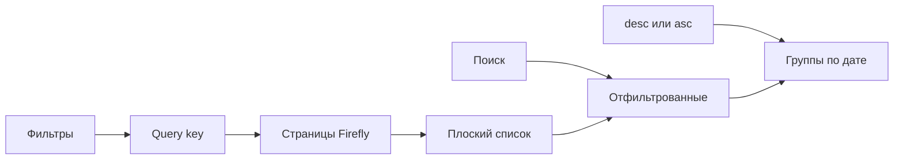

# US-033: переключатель сортировки History

Следующая история с `passes: false` и наивысшим приоритетом — **US-033**. Ссылок на Figma нет (`designReference: []`).

Список History уже грузит страницы Firefly по 10 (`listTransaction` / `listTransactionByTag`) и группирует их через [`groupAccountTransactions`](src/modules/budget/helpers/transactions/groupAccountTransactions.ts). Эта функция всегда сортирует даты и транзакции внутри дня от новых к старым. В [`schema.yaml`](schema.yaml) и сгенерированном клиенте у этих эндпоинтов нет параметра сортировки, `src/api` не трогаем. Сортировка остаётся на уже загруженных элементах и **не входит** в ключ `['history', 'transactions', filters]` — иначе Query начнёт новый запрос, а порядок с сервера не изменится. Поиск и фильтры работают как сейчас: поиск режет список на клиенте, фильтры по-прежнему перезапрашивают Firefly с первой страницы.

Детали счёта в Budget вызывают `groupAccountTransactions` без второго аргумента и остаются «сначала новые».

## Поведение

- По умолчанию `desc`: группы и транзакции внутри дня от новых к старым. Иконка Phosphor `SortDescendingIcon`.
- Клик переключает на `asc`: от старых к новым, иконка `SortAscendingIcon`. Следующий клик возвращает `desc`.
- Кнопка в тулбаре [`History.tsx`](src/modules/history/History.tsx) после фильтра и бейджа. Тот же размер, что у Filter (`ActionIcon`, `variant="default"`). Заливка кнопки не меняется — меняется только иконка.
- `aria-label` — ключ `history.sort` (`Sort`). `aria-pressed` истинен только в `asc`, чтобы в браузере было видно недефолтное состояние.
- Бейдж фильтров sort не считает.
- После переключения список прокручивается наверх, чтобы новая первая дата была видна сразу.
- Подгрузка по скроллу не меняется: Firefly по-прежнему отдаёт страницы от новых к старым. В `asc` новая страница вливается в уже загруженное и список пересортировывается целиком. Это ограничение клиента, не отдельный запрос «с самой старой транзакции».

## Шаги

1. В [`groupAccountTransactions.ts`](src/modules/budget/helpers/transactions/groupAccountTransactions.ts) добавить второй аргумент порядка, по умолчанию `desc`. Для двух направлений — тернарный компаратор строк (`date` у групп, `dateTime` у карточек). Вызов в [`AccountDetailsBody.tsx`](src/modules/budget/components/AccountDetailsModal/AccountDetailsBody/AccountDetailsBody.tsx) не менять.
2. Константу порядка положить рядом с группировкой (объект `desc` / `asc` и тип из него), чтобы History не завёл второй набор строк. В [`groupAccountTransactions.test.ts`](src/modules/budget/helpers/transactions/tests/groupAccountTransactions.test.ts) оставить текущий тест на дефолт и добавить случай `asc`: даты `2026-01-10`, затем `2026-01-15`; внутри дня сначала полдень, потом вечер.
3. В [`useHistoryList.ts`](src/modules/history/hooks/useHistoryList.ts) держать порядок в `useState`, по умолчанию `desc`. Группировать уже после `filterAccountTransactions`. Переключатель меняет состояние и делает `scrollTop = 0` у `scrollRoot`. Наружу отдать текущий порядок и переключатель. В ключ Query и в `toHistoryTransactionsQuery` порядок не класть.
4. В [`History.tsx`](src/modules/history/History.tsx) добавить кнопку. Иконку выбрать двумя статическими JSX-ветками, не переменной-компонентом (`react-hooks/static-components`). Общий класс размера с Filter вынести в одно имя в [`History.module.css`](src/modules/history/History.module.css), чтобы не копировать `--ai-size`.
5. Строку `history.sort: 'Sort'` добавить в [`src/i18n/en.ts`](src/i18n/en.ts).

## Проверка

- `npm test` — Vitest, включая новый кейс `asc` и старый дефолт `desc`.
- `npx tsc -b --pretty false`
- `npm run lint`
- Браузер на `http://localhost:5175/monetta/history` (Vite `strictPort` 5175), как в истории — через agent-browser:
  - без клика даты идут от новых к старым, иконка нисходящая, `aria-pressed` ложен;
  - клик по Sort сразу переставляет загруженные группы и карточки внутри дня от старых к новым, иконка восходящая, `aria-pressed` истинен, список у верхнего края;
  - второй клик возвращает порядок и иконку;
  - поиск по-прежнему фильтрует уже отсортированный список; бейдж фильтров от Sort не растёт;
  - карточки в деталях счёта на Budget остаются от новых к старым.
