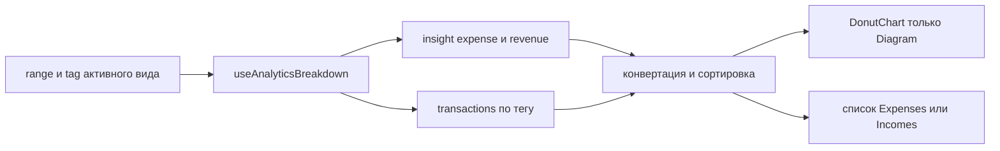

# US-036: DonutChart расходов и рейтинговые списки

Figma-ссылок нет (`designReference: []`).

Каркас уже есть: [src/modules/analytics/Analytics.tsx](src/modules/analytics/Analytics.tsx) рисует Diagram/Chart, фильтры, подпись периода и пустой `.visualization`, затем переключатель Expenses/Incomes. Период активного вида уже лежит в `useAnalyticsFilters` как `{ from, to }` — оба значения это `YYYY-MM-DD` на первое число месяца. Подпись периода не переносить.

## Что видит пользователь

Только при `view === diagram`, над диаграммой и рядом с уже существующей подписью периода: заголовок **Expense breakdown** (`analytics.expenseBreakdown`). На Chart заголовка нет — его добавит US-038.

В `.visualization` при Diagram:

- `@mantine/charts` `DonutChart` (пакет 9.5.2 уже в зависимостях, стили уже подключены в [src/App.tsx](src/App.tsx)). Сегменты — расходы периода. `withLabels`, `labelsType="percent"` (в этой версии подпись — `N%`), `withLabelsLine`, `tooltipDataSource="segment"`, `valueFormatter` через `formatWalletAmount`.
- В центре `chartLabel` — итог в основной валюте. Это `string | number`, не React-узел.
- Справа своя легенда: цвет, имя, процент, сумма. Встроенный `withLegend` не использовать: `ChartLegend` умеет только цвет и имя и по умолчанию стоит снизу.
- Узкий экран (тот же порог 520px, что у фильтров): диаграмма, под ней легенда. От 520px — ряд, легенда справа.

Под переключателем Expenses | Incomes — список выбранной стороны: имя, процент, сумма, по убыванию суммы. Переключение на Incomes диаграмму не меняет: диаграмма всегда из расходов. Списки и диаграмма используют период **активного** вида, поэтому на Chart списки уже считаются по диапазону графика, а слот визуализации остаётся пустым до US-038. Свайп точек не делать (US-037).

Пустой успешный ответ: диаграмму не монтировать (пустой `data` у Recharts бесполезен), в центре `0.00` с символом основной валюты, список пустой. Нет курса хотя бы у одной суммы категории — вся эта категория `null`, на экране `—`, как в parameters bar ([src/modules/budget/components/ParametersBar/ParametersBar.tsx](src/modules/budget/components/ParametersBar/ParametersBar.tsx)). Частичную сумму не показывать. Нет кеша: `analytics.loading`. Ошибка без данных: `analytics.loadFailed`.

## Данные

Один `useQuery`. Ключ `['analytics', 'breakdown', start, end, tag]`. `start = range.from`, `end = endOfMonth(range.to)` из [src/modules/budget/helpers/month/budgetMonth.ts](src/modules/budget/helpers/month/budgetMonth.ts). Это полный календарный месяц, как фильтр Month в History. `monthRange` / `fireflyBalanceDate` не использовать.

Без тега — два insight-запроса, ответ это сырой массив, как в [src/modules/budget/helpers/month/fetchBudgetInsights.ts](src/modules/budget/helpers/month/fetchBudgetInsights.ts):

- расходы: `insightExpenseExpense` (`/v1/insight/expense/expense`) — счета expense, строка на валюту;
- доходы: `insightIncomeRevenue` (`/v1/insight/income/revenue`) — счета revenue.

У этих методов в сгенерированном клиенте нет параметра тега. Если тег выбран — одна проходка `listTransactionByTag` через `collectFireflyPages` (`start`, `end`, свой page limit, не чужой «50»). Дальше `toAccountTransactions`. Withdrawal группировать по `destinationId`, deposit по `sourceId`. Transfer, reconciliation и opening balance не входят ни в расходы, ни в доходы. Сумма журнала — `amount` + `currencyCode`, foreign amount второй раз не прибавлять.

Дальше чистая функция: `Math.abs` по `difference` (расходы Firefly бывают отрицательными), пропуск пустого id/имени/нечисла, склейка валют одного счёта, `convertToPrimary` / `sumToPrimary`, сортировка по убыванию, процент от итога категории как `(amount / total * 100).toFixed(0)` — тот же вид, что подписи сегментов. Нулевые доли не попадают в сегменты и список.

Цвет сегмента и легенды — `color` счёта из `useBudgetAccounts(startOfMonth(today))`, иначе `DEFAULT_ACCOUNT_COLOR`. Загрузка счетов диаграмму не блокирует. Скрытый счёт, которого нет в Budget, остаётся в разбивке с цветом по умолчанию, чтобы итог не расходился с Firefly. Liability/debt эти insight-методы не отдают; отдельный запрос за долгами не добавлять.

Префикс ключа добавить в `TRANSACTION_QUERY_KEYS` в [src/modules/budget/helpers/transactions/invalidateTransactionQueries.ts](src/modules/budget/helpers/transactions/invalidateTransactionQueries.ts), чтобы save/delete транзакции обновляли Analytics вместе с Budget и History. `src/api` не менять.

## Файлы

- [src/modules/analytics/helpers/analyticsBreakdown.ts](src/modules/analytics/helpers/analyticsBreakdown.ts) — период, склейка insight-строк, группировка журналов, конвертация, сортировка, проценты.
- [src/modules/analytics/helpers/fetchAnalyticsBreakdown.ts](src/modules/analytics/helpers/fetchAnalyticsBreakdown.ts) — ветка insight / tag.
- [src/modules/analytics/hooks/useAnalyticsBreakdown.ts](src/modules/analytics/hooks/useAnalyticsBreakdown.ts) — тонкий `useQuery` плюс валюта и курсы теми же ключами, что US-014.
- [src/modules/analytics/constants/queries.ts](src/modules/analytics/constants/queries.ts) — ключ и свой page limit.
- [src/modules/analytics/components/ExpenseBreakdown/](src/modules/analytics/components/ExpenseBreakdown/) — диаграмма и легенда, CSS module рядом.
- [src/modules/analytics/components/AnalyticsRankList/](src/modules/analytics/components/AnalyticsRankList/) — список под переключателем.
- Правки [src/modules/analytics/Analytics.tsx](src/modules/analytics/Analytics.tsx), [src/modules/analytics/Analytics.module.css](src/modules/analytics/Analytics.module.css), [src/i18n/en.ts](src/i18n/en.ts).

## Проверка

- `npx tsc -b --pretty false`
- `npm test` — хелперы: склейка двух валют одного счёта, `Math.abs`, пропуск битой строки, сортировка, процент, нет курса даёт `null` на всю категорию, теговый журнал кладёт withdrawal в расходы и deposit в доходы и игнорирует transfer. Мок SDK как у `fetchBudgetInsights`. Компонентные тесты не писать: Vitest в `environment: 'node'`.
- `npm run lint`
- Браузер, маршрут `/#/monetta/analytics`: диаграмма и легенда за текущий месяц, центр в основной валюте, проценты на сегментах; список Expenses совпадает с сегментами; Incomes меняет только список; смена From/To и тега обновляет цифры; переключение на Chart убирает диаграмму и оставляет списки по диапазону графика. Свайп не появляется.
