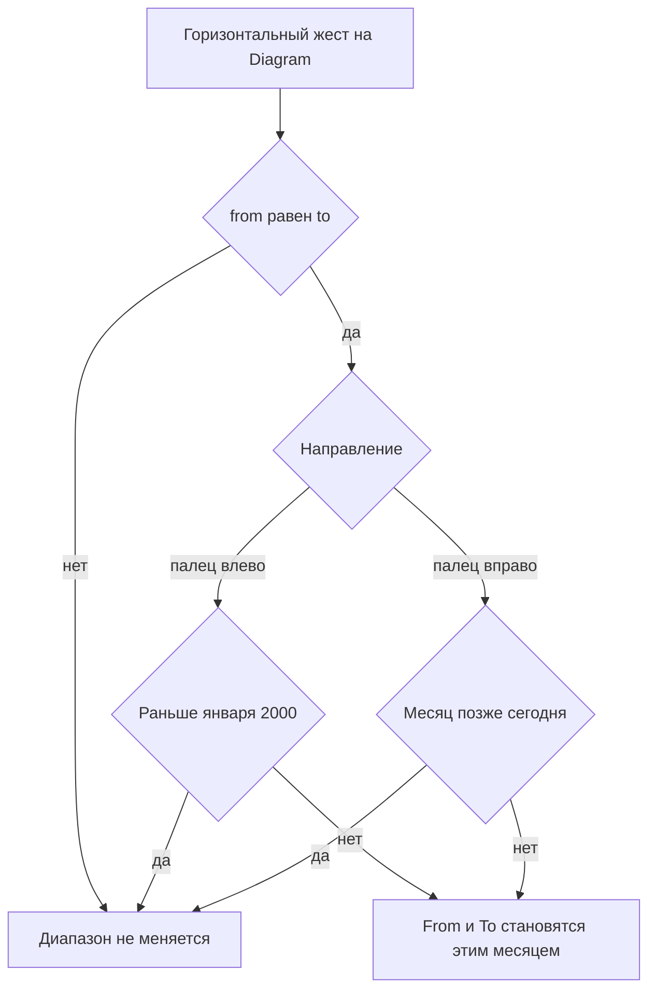

# US-037: свайп месяцев на Diagram

Figma нет: у истории пустой `designReference`.

Работа только по US-037. График Chart (US-038), выход (US-039) и клик по строке рейтинга (US-041) не трогаем.

## Поведение

Свайп и точки живут на блоке диаграммы и читают только `ranges.diagram`.

- Включён, когда открыт Diagram и `from === to` (любой один месяц, не только текущий).
- Палец влево пишет прошлый месяц в From и To. Палец вправо пишет следующий. Если следующий месяц позже `startOfMonth(today)`, жест ничего не меняет.
- Нижняя граница — январь `ANALYTICS_MIN_YEAR` (2000): список годов в фильтрах начинается с этого года, более ранний месяц в селекте не отобразится.
- После смены месяца тег, Expenses/Incomes и диапазон Chart остаются. Повторный свайп идёт уже от нового месяца.
- Период длиннее месяца: точки скрыты, жест не перехватывается. Пользователь снова ставит From и To в один месяц — точки и свайп возвращаются. Отдельный «режим после свайпа» не нужен: и жест, и точки считаются из текущего диапазона.
- На Chart точек нет, и жест месяца не вешается. Свой диапазон Chart сохраняется при переключении вида.

Точки — индикатор, без клика. Месяц на экране подсвечен.

- Текущий месяц: две точки (прошлый и показанный), активна вторая. Следующий месяц ещё не начался.
- Прошлый месяц, у которого следующий уже наступил: три точки (прошлый, показанный, следующий), активна средняя.
- Январь 2000: точки прошлого месяца нет, активна первая из оставшихся.

Карусель Budget не переносится. Там палец влево листает следующую страницу счетов. Здесь палец влево — прошлый месяц, и соседние месяцы не рисуются вторым и третьим DonutChart: смена диапазона уже перезапрашивает `['analytics', 'breakdown', start, end, tag]`.

## Шаги

1. Чистые функции в [src/modules/analytics/helpers/analyticsPeriod.ts](src/modules/analytics/helpers/analyticsPeriod.ts). React-файлы dayjs не импортируют; сдвиг месяца остаётся в хелпере, как `startOfMonth` в Budget.
   - `shiftAnalyticsMonth(monthStart, delta)` — первое число месяца.
   - `stepDiagramMonth(range, direction, today)` — `null`, если период не один месяц, месяц в будущем или раньше `2000-01-01`; иначе `{ from, to }` на этот месяц.
   - `diagramMonthDots(range, today)` — `null` при периоде длиннее месяца, иначе `{ count, activeIndex }`.
   - Направление: константа `DIAGRAM_MONTH_SWIPE` (`previous` | `next`) в [src/modules/analytics/constants/analytics.ts](src/modules/analytics/constants/analytics.ts). Две ветки — через условие, без `never`.

2. Тесты в [src/modules/analytics/helpers/tests/analyticsPeriod.test.ts](src/modules/analytics/helpers/tests/analyticsPeriod.test.ts): шаг назад и вперёд, запрет будущего месяца, запрет месяца до января 2000, `null` на диапазоне длиннее месяца, две точки на текущем месяце, три на прошлом, без прошлой точки на январе 2000.

3. В [src/modules/analytics/hooks/useAnalyticsFilters.ts](src/modules/analytics/hooks/useAnalyticsFilters.ts) добавить `setDiagramRange`. Пишет только `ranges.diagram`. `setRangeBound` и `clampAnalyticsRange` для селектов остаются как есть: если после свайпа пользователь разводит From и To, диапазон снова длиннее месяца.

4. Хук `useDiagramMonthSwipe` в `src/modules/analytics/hooks/`. Порог и захват оси — те же `PAGE_SWIPE_PX` и `PAGE_SWIPE_AXIS_LOCK_PX` из [src/modules/budget/constants/layout.ts](src/modules/budget/constants/layout.ts). Смысл направления свой: `dx < 0` — previous, `dx > 0` — next. Вертикальный жест отдаётся легенде. `enabled === false` — обработчики сразу выходят. После свайпа `click` глотается, чтобы жест не стал кликом.

5. Компонент `DiagramMonthPager` (`src/modules/analytics/components/DiagramMonthPager/`) оборачивает содержимое слота диаграммы: donut или статус загрузки. `touch-action: pan-y`. Точки под графиком, визуально как точки Budget (0.5rem, приглушённый фон, активная `indigo-4`), разметка `span` с `aria-hidden`. Подпись периода над фильтрами уже называет месяц.

6. В [src/modules/analytics/Analytics.tsx](src/modules/analytics/Analytics.tsx) обернуть содержимое `.visualization` в `DiagramMonthPager` только при `view === diagram`. Ветка Chart остаётся пустым слотом или статусом загрузки.

Новые пользовательские строки не нужны: тексты периода уже идут через `analytics.months.*`.

## Проверка

- `npx tsc -b --pretty false`
- `npm run lint`
- `npm test`
- Браузер, маршрут `/#/monetta/analytics` (HashRouter), уже открытая сессия:
  - Diagram на текущем месяце: две точки, активна вторая. Жест вправо не меняет From, To и подпись периода. Жест влево ставит прошлый месяц в оба поля, подпись и график обновляются, точек становится три, средняя активна.
  - Жест вправо с прошлого месяца возвращает текущий.
  - Развести From и To на несколько месяцев: точки пропадают, жест диаграмму не листает. Снова один месяц — точки и свайп на этом месяце.
  - Chart: точек нет, жест не меняет From/To графика. Возврат на Diagram показывает месяц, до которого долистали.
